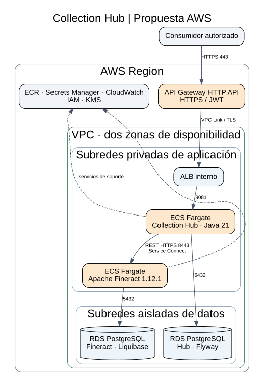

# Diagrama de arquitectura AWS

Fuente editable: [Graphviz DOT](arquitectura-aws.dot). Para regenerar el diagrama: `dot -Tsvg arquitectura-aws.dot -o arquitectura-aws.svg`.

El diagrama representa una propuesta lógica distribuida en dos zonas de disponibilidad, no recursos desplegados. Las bases son independientes y no tienen acceso público. Las líneas discontinuas representan servicios de soporte. Los puertos son los previstos para el despliegue; validar listeners, certificados y health checks al implementar.
